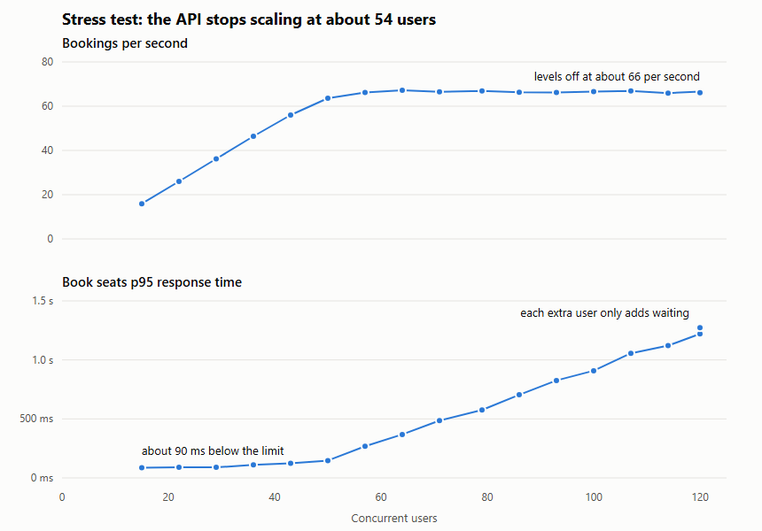

# Performance testing with Apache JMeter

[](https://github.com/niranjankagri/jmeter-performance-testing/actions/workflows/perf.yml)

Performance tests with **Apache JMeter** for a small ticket-booking API that lives in this repository. Every run starts
its own copy of the API, so the tests put load on nobody else's server. Java 21, JMeter 5.6.3, Maven, JUnit 6.

| | |
|---|---|
| Tests | One `.jmx` plan, four load profiles: smoke, load, stress, spike |
| Pass or fail | An SLO gate: JMeter has no built-in pass or fail for a slow p95, so `SloGate` reads the results and fails the build |
| Correctness | After the load, the plan checks that the limited event was never oversold |
| Reports | JMeter's HTML dashboard, and a Markdown table in every CI run summary |
| Finding | The stress test measured the booking limit at about 66 per second, from about 54 users |

## What the stress test found



Bookings need one of four payment connections for 40-80 ms, which allows about 66 per second. The stress test found
exactly that: past about 54 users, throughput stays flat and each extra user only adds waiting. p95 rose from about
90 ms to 1.3 s with no errors, so an error-based check alone would have seen nothing wrong.

| Profile | Users | Book seats p95 (local) | Errors |
|---|---|---:|---:|
| `smoke` | 5 | under 100 ms | 0 |
| `load` | 30 | about 104 ms | 0 |
| `spike` | 15, plus 80 for 20 s | about 860 ms in the burst, back to 87 ms within 10 s | 0 |
| `stress` | rising to 120 | about 1.2 s overall, up to 1.3 s at the end | 0 |

These figures come from my laptop, with the load generator and the API on the same machine.

## Run it

```
./mvnw verify               unit tests, then the smoke profile (about a minute)
./mvnw verify -Pload        also: -Pstress, -Pspike
```

Windows: use `mvnw.cmd`. Java 21 or newer is all it needs: Maven downloads JMeter, and no Docker or account is needed.
The HTML dashboard is at `target/jmeter/reports/booking/index.html`, and the SLO table at `target/slo-report.md`.

To open the plan in the JMeter GUI, run `./mvnw jmeter:configure jmeter:gui -DguiTestFile=src/test/jmeter/booking.jmx`.

## The API under test

| Endpoint | What it does |
|---|---|
| `POST /login` | Gives a token to one of 200 test users |
| `GET /events`, `GET /events/{id}` | 20 events, one of them with only 101 seats |
| `POST /bookings` | Books seats; `409` when sold out; needs a payment connection |
| `GET /bookings/{id}` | Reads a booking back, for its owner only |

## The test plan

`src/test/jmeter/booking.jmx`, with each element's purpose written in its comment field:

```
Base load, Burst           users, ramp-up and duration come from the profile
  Once per user            Login
  Browse events            GET /events (random pick) + GET /events/{id}
  Think time               200-400 ms
  Book seats               POST /bookings, accepts 201 or 409, counts confirmed seats
  Only if booked           Check booking
  Think time               200-400 ms
After the test             Check no overselling: the API's count against the test's own
```

## What is tested

| Layer | Where | Tests |
|---|---|---:|
| API behaviour | `BookingApiTest` | 11 |
| Seat count under real concurrency | `EventTest` (one test, repeated 20 times) | 20 |
| Statistics | `LabelStatsTest` | 3 |
| Results file | `JtlReaderTest` | 4 |
| SLO gate | `SloGateTest` | 9 |
| Performance | `booking.jmx` with the four profiles | |

**47 unit tests.** The API is tested first because a load test of a broken API measures nothing.

## Design

| Pattern | Where | Why |
|---|---|---|
| One plan, data-driven load | `booking.jmx`, profiles in `pom.xml` | The flow exists once; a profile changes only the numbers |
| Transaction Controllers | `booking.jmx` | Results and SLOs speak in business steps, not URLs |
| Client object | `ApiClient` (tests) | Paths and JSON in one place; tests read as behaviour |
| Test data builder | `Samples` (tests) | A gate test states only the numbers it's about |
| Gate as code | `gate/` | Pass or fail is reviewed, versioned and unit-tested like any other code |

More in [docs/framework-design.md](docs/framework-design.md).

## Documents

- [Framework design](docs/framework-design.md): the decisions, and what went wrong on the way
- [Manual test cases](docs/manual-test-cases.md): every case in plain language, by ID
- [Interview questions](docs/interview-questions.md) ([PDF](docs/interview-questions.pdf)): 60 questions on performance
  testing and JMeter, answered with this project

## What this does not prove

The API and its limit are built for this project, so the numbers describe this demo and not any real system. JMeter's
thread groups are a closed model: a slow system receives less load, so overload looks milder than it would with real
public traffic. There's no soak test, and no server-side monitoring.

## License

[MIT](LICENSE)
